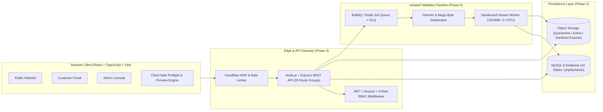

# Application Architecture — SheetSentry

## 1. High-Level System Topology (from `122:2` & `23:2`)

## 2. Frontend Architecture (Phases 1 & 2)
- **Framework**: React 18 + TypeScript + Vite + Tailwind CSS + React Router.
- **Modular Directory Structure**:
  - `src/config/productConfig.ts`: Single Source of Truth (SSOT) for plan entitlements, provisional conflict comparison data (`138:2` vs `22:555`), DQS formula parameters, grade thresholds, and worker resource ceilings.
  - `src/services/spreadsheetParser.ts`: Safe client-side CSV/TSV/Workbook parser with magic-byte detection (`50 4B 03 04` for XLSX/ZIP, UTF-8 byte sequence check for CSV), delimiter inference, header detection, and zip-bomb ratio estimation.
  - `src/services/validationEngine.ts`: Deterministic validation rule evaluator (Required, Type, Regex, Unique, Range, Enum, Cross-column) + Formula Injection Neutralizer (`=`, `+`, `-`, `@`, `\t`, `\r` escaped with leading `'`).
  - `src/context/AppStateContext.tsx`: Interactive state store managing active workspace, selected plan & currency (`USD` / `PHP`), uploaded files, validation profiles, validation jobs, and immutable audit log entries (including ticket-gated admin inspections).
  - `src/components/`: Reusable layout shells (`PublicLayout`, `CustomerLayout`, `AdminLayout`) and atomic UI components (`StatusBadge`, `ProvisionalBanner`, `TicketGateModal`, `ConnectionsPopover`).
  - `src/pages/public/`: All 8 public marketing and authentication screens.
  - `src/pages/customer/`: All 12 customer portal screens and multi-step upload/rule-builder wizards.
  - `src/pages/admin/`: All 10 admin console governance screens.

## 3. Worker Resource & Streaming Architecture (`138:2` Section 7)
- **Container Memory Ceiling**: `1,024 MB` hard container limit (`< 250 MB` resident operational average).
- **Backpressure Pause/Flush Threshold**: `850 MB` heap watermark triggers stream pause and batch flush.
- **CPU Allocation**: `2 vCPU` maximum per isolated worker container.
- **Streaming Chunk Size**: `5,000 rows` per batch (`2,000 rows` memory checkpoint interval).
- **Execution Timeout & Retries**: `300 seconds` (`5 minutes`) hard timeout; up to `3` automatic retries with exponential backoff (`5s`, `15s`, `45s`) before routing to the Dead-Letter Queue (`DLQ`).
